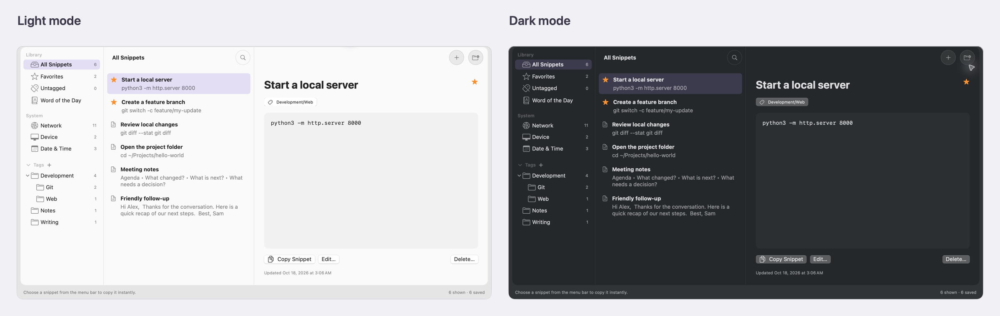

# SnippetShelf

Save, organize and copy text snippets from a native macOS app or the menu bar.
Group snippets with nested tags, keep a Word of the Day with its definition, and
copy live system information—all stored or resolved locally, without third-party
dependencies.

## Requirements and installation

The **0.1.0-beta.1 DMG supports Apple Silicon Macs running macOS 27.0.1**, the
configuration tested for this beta. Intel Macs and earlier macOS versions have
not been verified and are not supported by this download. **Xcode is not required.**

1. Open [GitHub Releases](https://github.com/drodriques/SnippetShelf/releases),
   choose the beta marked **Pre-release**, and review its known issues.
2. Under **Assets**, download **`SnippetShelf-0.1.0-beta.1-arm64.dmg`**.
   GitHub's **Source code** archives are not app installers.
3. Open the DMG and drag **SnippetShelf** into **Applications**.
4. Eject the DMG and launch **SnippetShelf** from **Applications**. Confirm the
   normal macOS downloaded-app prompt if shown.

To update, quit SnippetShelf and install the newer DMG, replacing the app in
Applications. Your saved snippets and words remain intact. Updates are manual.

## Quick start

1. Click **+** or press **⌘N** to create a snippet. Add a title and text, then
   choose **Save Snippet**.
2. Use **+** beside **Tags** to create a tag, then assign it in the snippet editor.
   Mark useful snippets as favorites for quick access.
3. Press **⌘F** to search the selected group by title or content.
4. Select a snippet and click **Copy Snippet**, or choose it from the menu bar.
   Paste into your destination with **⌘V**.

Closing the window keeps the menu bar available. Click the Dock icon to reopen
the window; use **⌘Q** to quit the app.

## Features and shortcuts

- **Nested tags:** organize snippets into branches and browse a whole group.
- **Word of the Day:** keep one current word, edit its history or reuse a past word.
- **System actions:** copy local network addresses, device information and dates.
- **Appearance:** resize panels, collapse the sidebar, choose Auto/Light/Dark,
  and adjust optional background translucency in **Settings…**.

| Action | Shortcut |
| --- | --- |
| New snippet, or new word while viewing Word of the Day | ⌘N |
| Search the selected group | ⌘F |
| Copy the selected snippet or System value | ⇧⌘C |
| Open Settings | ⌘, |
| Expand or contract the sidebar | Control–Command–S |
| Enter or leave fullscreen | Control–Command–F |
| Insert emoji while editing text | Control–Command–Space |

## Privacy and backups

Snippets and words are saved locally as **unencrypted JSON**; there is no cloud
sync. System values are read locally, and copying places plain text on the macOS
clipboard. Clipboard tools and Universal Clipboard may access it according to
your settings.

Back up both `snippets.json` and `words.json` in
`~/Library/Application Support/SnippetShelf/` while the app is closed. Uninstalling
the app leaves these files in place. See [storage and backup instructions](docs/USER_GUIDE.md#storage-and-backups)
before restoring a backup.

## Learn more and contribute

See the [user guide](docs/USER_GUIDE.md) for tags, word history, settings and
menu-bar instructions, or open **Help → SnippetShelf Help** for offline guidance.
For source builds, developer setup and testing, see [CONTRIBUTING.md](CONTRIBUTING.md).

## License

Copyright (c) 2026 SnippetShelf contributors.

Licensed under the [GNU General Public License, version 3 only](LICENSE)
(`GPL-3.0-only`). See [LICENSE](LICENSE) for the full terms.
